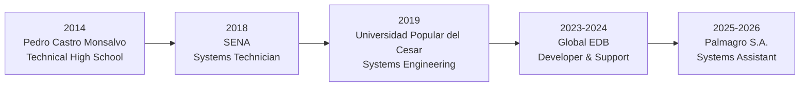
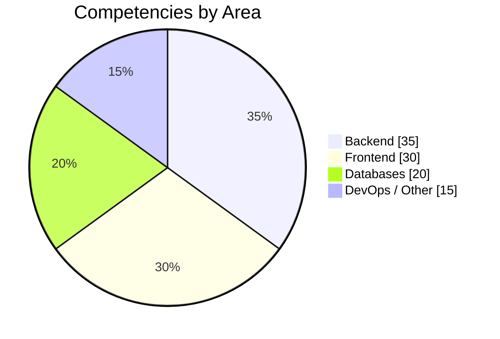

# Angel David Bolaño Aroca
## Developer | Software Engineer

  

---

## 📇 Contact

| Information | Detail |
|-------------|--------|
| **Email** | [angeldavidbolanoaroca@gmail.com](mailto:angeldavidbolanoaroca@gmail.com) |
| **Phone** | +57 316 326 3984 / +57 318 937 9903 |
| **LinkedIn** | [angel-david-bolaño-aroca](https://www.linkedin.com/in/angel-david-bolaño-aroca-a6282b280/) |
| **GitHub** | [angeldavid2002](https://github.com/angeldavid2002) |

---

## 💼 Professional Experience

### Developer & Support \| Global EDB
*Valledupar, Colombia \| Nov 2023 - Dec 2024*

**Global EDB** — Clinical management platform developed with Angular and .NET Core
- Designed and optimized database schemas in SQL Server
- Implemented JWT authentication and role-based policies
- Built low-code solutions with Microsoft Power Platform
- Automated processes using Python scripts
- Provided technical support to external companies (servers, APIs, web clients)

### Systems Assistant \| Palmagro S.A.
*Valledupar, Colombia \| Nov 2025 - May 2026*

**Palmagro S.A.** — Process automation and central database management
- On-site technical support: hardware, software, and connectivity
- Cable management, network connections, and equipment maintenance
- End-user technical assistance

---

## 🎓 Education

**Universidad Popular del Cesar** — Systems Engineering (Graduated)

**SENA** — Systems Technician

---

## 🔧 Tech Stack

### Backend
    

### Frontend
 

### Databases
 

### Tools & Methodologies
   

---

## 💻 Skills

### Frameworks & Technologies (1-2 years)
- **FastAPI** — 1-2 years
- **Node.js** — 1-2 years
- **Spring Boot** — 1-2 years
- **Angular** — 1-2 years
- **React** — 1-2 years
- **PostgreSQL** — 1-2 years

### Frameworks & Technologies (3+ years)
- **.NET Core** — 3+ years
- **SQL Server** — 3+ years

### Additional Competencies
- **Architecture & Engineering Fundamentals** — SOLID, Clean Code
- **Access Control** — JWT, OAuth
- **QA & Testing** — Postman
- **Agile Methodologies** — Scrum, Git, GitHub
- **Basic DevOps** — CI/CD, GitHub Actions

---

## 🏆 Certifications

| Certification | Institution | Date |
|---------------|-------------|------|
| English for IT 1 | Cisco | 2023 |
| CCNA: Introduction to Networks | Cisco | 2022 |

---

## 🌐 Languages

- **Spanish** — Native
- **English** — B2 (Upper Intermediate)

---

## 📊 Professional Timeline

---

## 🧠 Competencies Distribution

---

> Designing scalable architectures and implementing solutions that transform.

---

**© 2026 Angel David Bolaño Aroca**  
[GitHub](https://github.com/angeldavid2002) • [LinkedIn](https://www.linkedin.com/in/angel-david-bolaño-aroca-a6282b280/)
